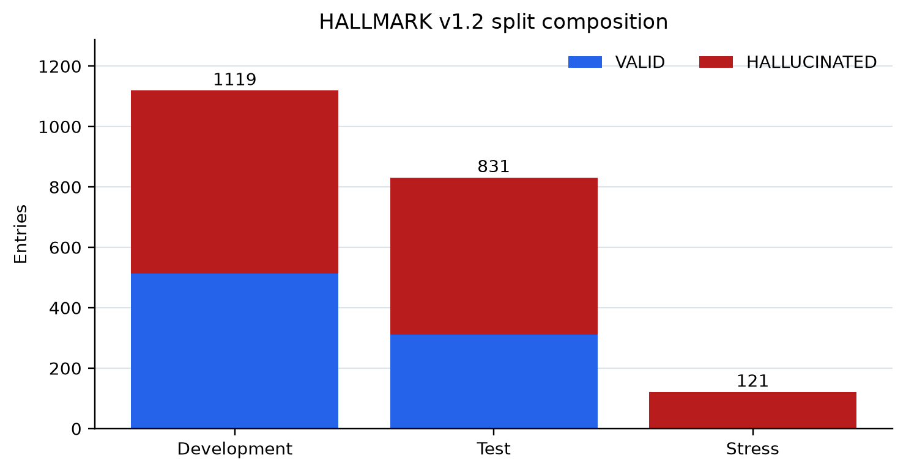
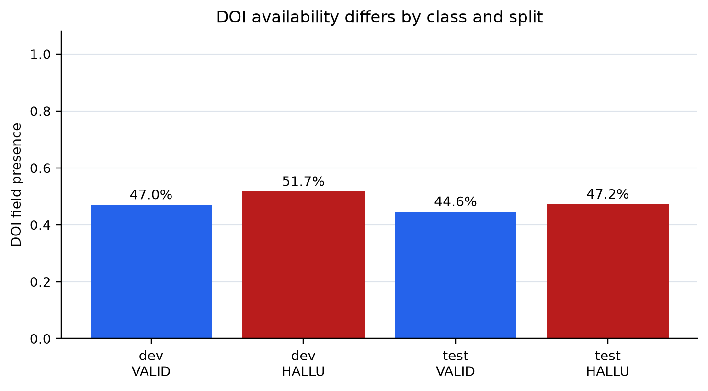
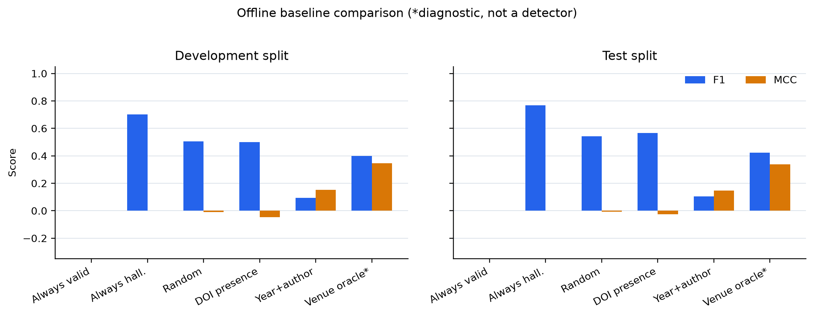
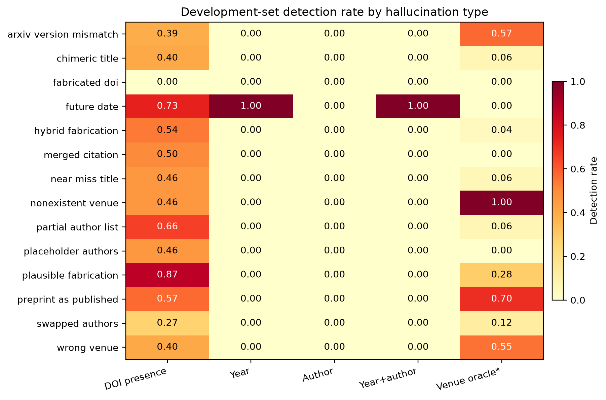
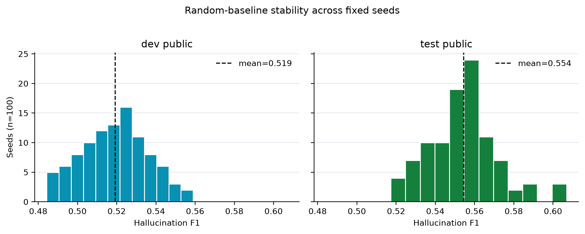
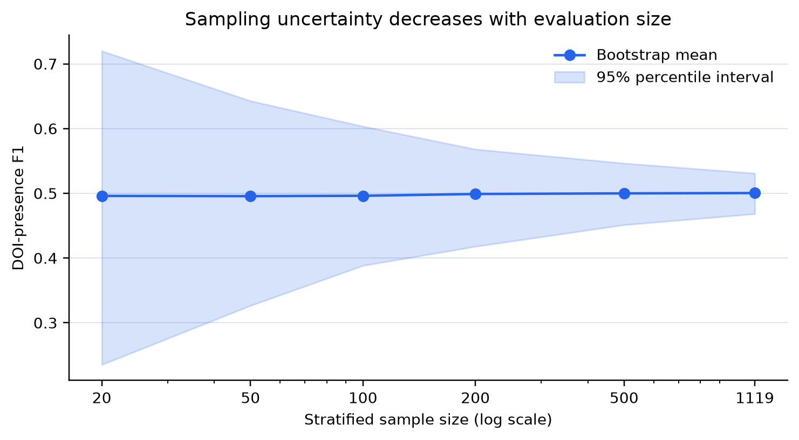
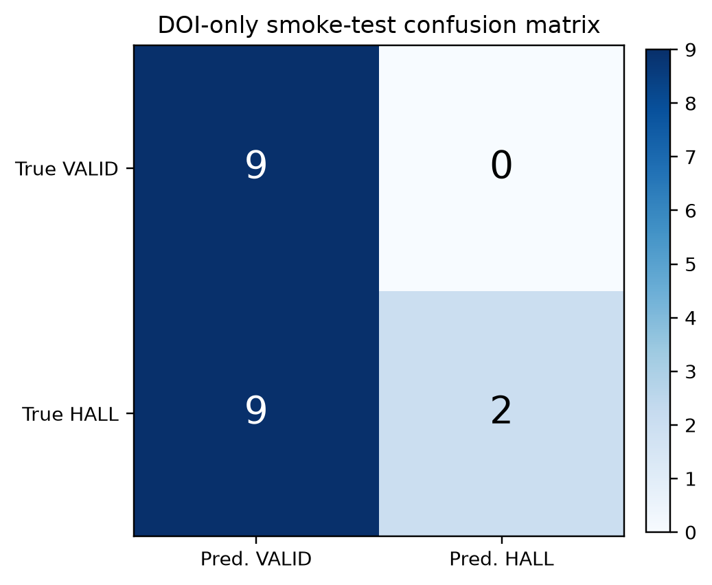
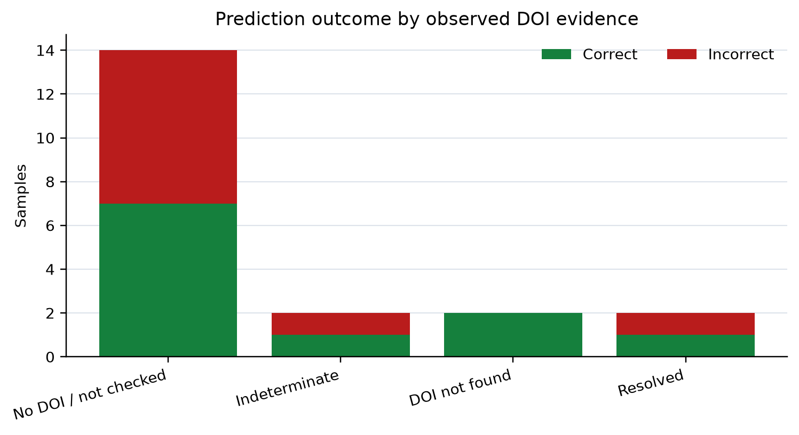
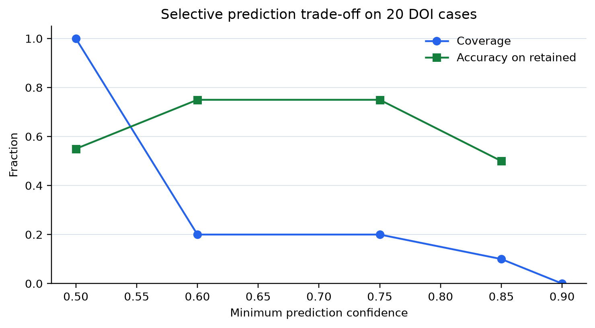

# 学术引用幻觉检测中低成本书目信号的有效性与局限

> 《文献真实性校验与证据对齐》课程项目最终课程论文 · [PDF 版](paper.pdf) · [代码与数据](README.md) · [复现说明](docs/reproduction.md)

## 目录

- [摘要](#摘要)
- [1 引言](#1-引言)
- [2 问题定义与能力边界](#2-问题定义与能力边界)
- [3 相关工作](#3-相关工作)
- [4 方法与实验设置](#4-方法与实验设置)
- [5 实验结果与分析](#5-实验结果与分析)
- [6 局限性与讨论](#6-局限性与讨论)
- [7 结论](#7-结论)
- [代码与数据可用性](#代码与数据可用性)
- [参考文献](#参考文献)

## 摘要

学术写作中的引用核验包含两个相互联系但不能混同的问题：被引用文献是否真实存在且书目信息是否准确，以及被引用内容是否真正支持正文论断。本文围绕这两个问题展开背景分析，并复现具有公开代码和数据的 HALLMARK。本文在无 GPU 的 CPU 环境完成 236 项核心测试与固定 20 条 DOI 可解析性在线样本，并新增三组可重复实验：对 v1.2 的开发集、测试集和压力集共 2,071 条记录进行字段与分布审计；在开发集 1,119 条和测试集 831 条上运行八种离线参考线及规则消融；以 100 个固定随机种子、每种规模 500 次分层重采样和 5,000 次在线结果 bootstrap 评估随机性与小样本不确定性。20 条 DOI-only 实测得到 Detection Rate 0.1818、F1 0.3077、MCC 0.3015，但只有 30% 样本发起 API 请求，具有明确“解析成功或未找到”证据的有效覆盖仅 20%。全量离线实验进一步显示，DOI 是否存在的启发式在开发集与测试集上的 F1 分别为 0.5004 和 0.5673，MCC 却为 -0.0466 和 -0.0258，说明其分数主要受到类别比例影响，不能视为有效鉴别能力；年份与作者规则保持零误报，却只能检出约 5% 的幻觉。九组实验图、逐样本预测、统一汇总 JSON、CSV 与运行脚本均收录于随文提交的代码与数据存档。全文以可审计实验分析低成本信号的能力边界、覆盖率含义、数据偏差和复现不确定性。

**关键词：** 文献真实性；引用幻觉；证据对齐；BibTeX；HALLMARK；可复现研究

## 1 引言

生成式模型和自动化写作工具降低了学术文本生产成本，也使引用错误更加容易规模化出现。一条看似规范的参考文献可能完全不存在，也可能只在标题、作者、年份、期刊、会议或 DOI 中存在局部错误；更隐蔽的情况是，文献确实存在，但正文将其研究对象、实验条件或结论方向描述错误。前一种问题属于文献实体真实性校验，后一种问题属于引用内容与原文证据的语义对齐。两者共享检索和来源管理基础设施，却具有不同的标签、证据和评价协议。

文献真实存在不等于文献支持该论断，“未检索到”也不等于“文献虚构”。这两个边界决定了系统保存来源、版本、查询时间和不确定性，不能把所有接口失败都转换为负标签。本文围绕复现过程回答三个问题：第一，文献真实性校验和证据对齐分别包含哪些技术环节；第二，公开实现和数据在普通 CPU 与受限网络条件下能否稳定复现；第三，一个轻量字段核验基线可以发现哪些错误、又会遗漏哪些错误。

本文以复现与分析为主线，组织超过十篇文献并深入讨论代表性方法，随后用 HALLMARK 的公开实现建立从数据、预测到统计图的闭环。相较于仅检查二十条在线记录，扩展实验增加了两个完整公开划分上的八类离线对照、数据构造偏差审计、随机基线重复运行和样本量敏感性分析。其研究价值不在于超过某个排行榜分数，而在于解释看似不错的分数究竟来自鉴别信号、类别比例还是输出默认值，并说明可解析 DOI 与完整书目正确性之间的差距。

本文提出四个可由实际数据回答的研究问题。其一，DOI 字段缺失能否成为幻觉检测的可靠捷径？其二，作者与年份这些不需要网络的规则，能覆盖哪些明确错误，又会漏掉哪些看似合理的拼接？其三，随机基线在不同类别比例和不同种子下的 F1 如何变化，小规模在线子集是否足以排序方法？其四，当系统默认输出 VALID 时，标签覆盖、查询覆盖和有效证据覆盖是否一致？实验保持官方标签、冻结基线规则和参考年份，不以测试集结果反向设计新算法。

## 2 问题定义与能力边界

### 文献真实性校验

文献真实性校验的输入可以是 BibTeX 条目、参考文献列表、正文引用块，或由解析器抽取的标题、作者、年份、venue、卷期页码和 DOI。本文将候选文献是否存在、字段匹配状态、检索来源、检索时间以及无法判断的原因作为输出字段。一个完整系统通常包含五步：引用结构解析、候选实体检索、字段级匹配、冲突诊断和不确定性聚合。候选实体检索可以调用 DOI 注册机构、Crossref、OpenAlex、Semantic Scholar、DBLP、出版社页面或预印本服务；字段级匹配涉及大小写、作者缩写、版本、标题标点和期刊简称等变体。

真实性判断的正类需要先定义。本文在 HALLMARK 实验中将 HALLUCINATED 设为正类，将 VALID 作为负类；UNCERTAIN 不被隐式改成正确或错误，而在覆盖率和指标中单独记录。实验将三个常见边界分别记录：DOI 无法解析不必然表示文献不存在，因为可能是接口异常或记录延迟；数据库没有返回全文不等于文献虚构；标题相似不代表作者、venue、年份和版本都相符。因此，字段级证据和来源覆盖率与最终标签同样重要。

### 证据对齐与支持关系判断

证据对齐的输入是一个待核验论断、一个被引文献及其摘要或全文，以及可选的候选证据句。输出通常包含文档级关系标签和句子、段落、表格或图的位置。关系标签可有支持、部分支持、矛盾和证据不足，但复现实验必须优先保留数据集原有标签体系。证据对齐一般包含论断规范化、候选文献或证据检索、候选重排、文档级判断、细粒度定位和置信度校准六个环节。

真实性和支持关系的区别可用一个简单例子说明：某篇论文确实存在且 DOI 正确，但正文声称“方法在所有数据集上均显著优于基线”，而原文只在一个数据集上报告提升。这条引用在实体层面为真实，在语义层面却只能得到部分支持或证据不足。反过来，模型可能找到与论断主题相似的摘要，但该摘要来自错误文献，不能替代原被引文献。因此本文将两个任务分别评价，不把 HALLMARK 的书目 F1 与 SciFact 的证据 F1 直接比较。

### 将检索状态、实体状态与支持状态分别建模

为了避免概念混淆，可以将一次引用核验记为三元输出 (s_access,s_entity,s_support)。第一项记录是否获得数据及失败原因，例如成功获取元数据、仅获取摘要、全文受限、超时或接口返回不确定；第二项回答标识符所指向的实体及各字段是否一致；第三项回答原文证据与具体论断之间的支持关系。三项虽然在流水线中存在先后依赖，却不能互相代替。例如，HTTP 200 属于获取层信号，不足以独立决定作者字段正确；HTTP 202 属于服务状态，不直接等价于文献虚构；全文下载失败属于证据范围限制，不直接等价于原文矛盾。

这一拆分对评价的影响十分具体。若将所有未获取全文的记录排除后仅报告准确率，结果可能反映数据库覆盖程度而不是核验能力；若把每个服务失败都记作幻觉，真实引用误报率会随网络波动上升；若用其他主题相近的论文替代原被引来源，则即使支持关系分类正确，也没有验证目标引用。本文实验只测量第二项中的少量书目信号，并对第一项做可观测的状态审计；第三项通过文献调研讨论，实证部分不纳入该层级的分数。这样的任务拆分也决定了后文图表的命名：混淆矩阵对应书目标签，HTTP 与 DOI 分组对应证据获取，二者的分母和含义分别给出。

从数据挖掘角度看，引用核验既包含实体消歧，也包含有噪标签下的分类、缺失数据处理和代价敏感决策。标题相似度会受术语替换与标点变化影响，作者匹配会受姓名缩写和排序影响，版本匹配会受到预印本与正式出版的时间关系影响。一个字段没有异常，只能说明该局部检查未发现矛盾。本文采用保守默认值的离线消融就是为了隔离局部规则贡献：未命中规则时仍可输出可评分标签，但必须注明它来自默认策略，不能将其解释为已经获得实质验证。

## 3 相关工作

### 证据对齐基准

SciFact 将科学论断与候选摘要组成 论断与摘要配对，并标注支持、反驳和无信息关系，同时提供 rationale 句[1]。它具有输入清晰、证据可解释的优点，适合建立句子级评价基线，但主要语料是摘要，不能代表完整 PDF 审查。MultiVerS 进一步使用 Longformer 对 claim 和完整摘要上下文进行联合编码，同时预测文档级标签和 rationale，试图避免先抽取短证据再判断导致的上下文丢失[2]。SciFact-Open 将语料扩展到约五十万篇摘要，并使用 pooling 标注构造开放域检索评价集，说明候选召回误差会显著影响端到端性能[3]。

### 真实性与引用幻觉工作

HALLMARK 将引用幻觉拆分为十四种错误类型和三个难度层级，包含 DOI 解析、标题匹配、作者一致性、venue 验证、字段完整性和跨数据库一致性等子测试[4]。CiteAudit 研究级联式核验，用低成本记忆、DOI 或 URL 信号先处理简单样本，再将难例交给检索服务或模型[5]。CiteTracer 将引用解析、证据收集、字段匹配和 Real/Potential/Hallucinated 判别拆开，强调字段级诊断[6]。RefVerifier 提供阶段性复核包，暴露全文获取率和不同阶段的失败原因[7]。这些工作更接近文献真实性核验，但通常需要外部数据库或网络服务。

### 一般来源归因与引用生成工作

ALCE 关注带引用的答案生成和引用精度、召回[8]；RAGTruth 提供生成回答的片段级幻觉标注[9]；AttributionBench 研究生成文本是否能被给定来源支撑[10]；MiniCheck 以轻量模型判断生成陈述是否被文档支撑[11]；RefChecker 进行基于参考文档的细粒度幻觉检测[12]；SemanticCite 将论断规范化、混合检索、重排和解释性判断组合到更完整的引用核验流程[13]。它们为检索器、重排器和细粒度评价提供了可迁移思路，但数据的正类、来源类型和评价对象与学术书目真实性不完全相同。

### SciFact 与 MultiVerS：证据范围和联合建模

SciFact 的关键贡献是把科学论断核验分解成可标注和可评价的单位：给定一条论断与一个科学摘要，既判断支持、反驳或无信息，又给出支持该判断的句子集合[1]。这使得文档分类的正确性可以与证据定位的正确性分开检查。若系统标签正确但 rationale 指错句，不能认为解释已经可靠；反之，检索到主题相关句子而关系标签错误，也不能认为完成论断核验。与一般网页事实核验相比，科学论断常包含实验对象、干预条件和统计关系，词面相似的摘要可能在方向或适用条件上相反，因此需要模型理解句间限定关系。

MultiVerS 对上述流程的一个重要回应是保留完整上下文，同时预测摘要级关系与句子级证据[2]。与先抽取短证据再分类相比，联合编码能让分类器接触否定、条件、实验设定和结论转折，减少只读局部片段带来的歧义。其弱监督利用额外训练信号扩充学习来源，但代价是模型、预训练权重、分词器与训练框架之间形成较紧耦合。这里的完整上下文应结合实验语料理解：用于 SciFact 时主要是完整摘要上下文，不能据此声称系统已自动审查 PDF 的所有图表和附录。

SciFact-Open 则改变了候选语料范围[3]。在给定正确摘要时，验证模型只需要解决关系判断；在约五十万篇摘要中检索时，端到端错误可能首先发生在召回阶段。由此可以理解为什么检索 Recall@k、证据 F1 与最终标签 F1 应分别报告。增大候选数量可能提高召回，却同时增加重排成本和不相关证据干扰。pooling 标注也意味着未标注候选不一定都是可靠负例。完整复现这一流程需要检索索引、语料版本和证据评价共同可用；仅运行给定证据分类器，不能被描述为开放域证据检索的复现。

### HALLMARK：多字段标签与廉价信号的局限

HALLMARK 的实验单位是结构化 BibTeX 条目，因此错误可以发生在多个彼此独立的字段[4]。当前代码的分类体系包含十一种主要错误模式与三种压力型模式，后者包括合并引用、作者列表不完整和 arXiv 版本不匹配；本次固定的公开文件实际也含这些压力型标签，故统计时以文件内容为准，而不根据类型名称私自剔除样本。有效引用并不分配幻觉难度层级，难度分布的分母只能是幻觉记录。字段级子测试采用 True、False、None，None 用于没有相应字段或不适用状态；因此“没有 DOI”与“对存在的 DOI 检查失败”必须区分。

这一设计使低成本信号的能力边界可以直接观察。DOI 解析能验证标识符的可访问状态，却无法检查同条记录的作者是否被换成其他论文的作者；年份边界能找到不合理的未来时间，却不会发现合理年份上的 venue 错配。官方代码还提供常量预测、随机预测、DOI 存在性和 venue oracle 等对照。它们的用途不相同：常量与随机用于建立统计参考；DOI 存在性用于测量缺失字段捷径；venue oracle 使用预设的少量有效 venue 集合作偏差诊断，源码明确说明其不是合法检测器。本文保留这些区分，不将偏差探针与具有外部证据的核验工具混为排行榜。

与 HALLMARK 相邻的 CiteAudit 关注科学参考文献核验的基准与检测框架[5]，CiteTracer 所在论文则将检索来源与多代理核验过程联系起来[6]。二者提示，仅凭语言模型内部记忆或单字段格式很难稳定覆盖多种幻觉；检索来源和字段诊断能补足证据，但也引入接口许可、速率限制、服务变化和调用费用。上述框架在本文中作为技术路线比较。轻量规则与公开数据可直接完成可审计验证，依赖外部数据库或模型服务的实验则需另行标注资源条件与调用成本。

### 来源归因与全文核验：可迁移之处及不可比较之处

ALCE 从生成侧要求答案附带引用[8]，但有引用标记并不意味着每个陈述都有来源支持。引用精度衡量所给引用的支撑程度，引用召回关注回答中需要支撑的陈述是否获得充分归因；这些指标的分母是生成内容或引用关系，而不是 BibTeX 条目数量。RAGTruth 的细粒度幻觉标注[9]与 RefChecker 的分解式检查[12]进一步说明，把一整段复合陈述压缩成单个真伪标签可能掩盖局部错误。一个回答同时包含正确背景和错误数字时，片段或原子事实评价比整体流畅度更有解释力，但也需要对齐到确定的参考材料。

AttributionBench 强调自动归因评价本身的困难[10]。将 LLM 用作评价者时，不能默认其输出就是人工真值；它可能依赖常识、语言相似度或训练记忆，而不是严格受给定来源约束。MiniCheck 以更小的模型完成文档支撑判断[11]，对有限资源预算具有启发，但轻量并不意味着任意硬件都可直接复现：权重可得性、推理框架、最大文档长度与数据格式仍需逐项确认。低延迟与高 F1 是不同维度，迁移到学术引用场景时还需要处理专业术语、表格证据和版本差异。

SemanticCite 在全文分析中区分 Supported、Partially Supported、Unsupported 和 Uncertain[13]；RefVerifier 则关注科学稿件中的参考论断半自动核验[7]。这类系统处理的是语义支持关系，其输入必须包括具体论断与对应来源，而 HALLMARK 的条目不自带需要核验的正文论断。不能把书目标签重新解释为支持关系标签。CiteCheck[14]和科学事实核验综述[15]也提示，任务定义与标签协议先于模型选择。本文的实证部分聚焦书目真实性模块，保持输入、标签、证据范围与结论一致。

**表 1：代表性工作与复现条件比较**

| 工作 | 主要任务与方法 | 数据或规模 | 核心指标 | 开源情况与主要限制 |
|---|---|---|---|---|
| SciFact | 论断—摘要关系与证据句 | 约 1,400 条论断、5,183 篇摘要 | label F1、句子 F1 | 数据和评价公开；摘要级，测试标签部分不可见 |
| MultiVerS | Longformer 完整上下文、多任务、弱监督 | SciFact、CovidFact、HealthVer | abstract F1、sentence F1 | MIT 代码公开；依赖预训练权重与旧版深度学习栈 |
| SciFact-Open | 开放域摘要检索与验证 | 约 50 万篇摘要、279 条 claim | evidence F1、Recall@k | 代码和数据公开；pooling 标注不等于穷尽负例 |
| HALLMARK | BibTeX 引用幻觉与字段核验 | v1.2 dev 1,119 条 | Detection Rate、F1、MCC、ECE | MIT，CPU 友好；完整基线依赖外部服务 |
| CiteAudit | 级联式引用真实性审计 | 生成与真实引用混合集 | F1、成本、覆盖率 | 代码与数据公开；检索 API 和费用影响复现 |
| ALCE / RAGTruth | 生成答案归因与片段幻觉 | ASQA、QAMPARI、ELI5 等 | 引用精度召回、片段 F1 | 可迁移到来源归因；不是专门书目真实性基准 |

## 4 方法与实验设置

### 复现对象选择

本项目选择 HALLMARK 作为主复现对象，依据是其官方实现以 MIT 许可公开，随仓库提供带金标签的公开划分与统一评价器，核心依赖仅为书目解析、HTTP 客户端与字符串相似度库，不依赖 GPU 或大模型权重，因而可在固定数据版本上完成完全离线、可逐样本复核的对照实验。与之相对，以证据对齐为目标的联合编码系统需要预训练权重、特定版本的深度学习框架与较长输入上下文，其资源条件应单独核算；本文将其作为技术路线对照，实证部分聚焦书目真实性模块。该选择同时界定了能力边界：书目字段核验不等价于论断与原文证据的语义支持判断。

### 版本、数据与基线设置

复现对象 HALLMARK 的官方仓库固定版本为
`f774fa40675daa83eca6201637a94c4536b7bb3e`，许可证为 MIT，要求 Python 3.10 以上。核心依赖为 BibTeX parser、HTTP 客户端和字符串相似度库，不依赖 CUDA、torch 或大模型。固定数据为 v1.2 的 `dev_public`，包含 1,119 条记录，其中 VALID 513 条、HALLUCINATED 606 条，覆盖 Tier 1--3 和多种生成方式。数据文件 SHA-256 为 e1d3fd8e66191dae1d9cc4317cec870a99966f4d558a8601ebf533b362ed263a，metadata SHA-256 为 085047b5b4b6911249c4225ae4ef406f9e5872fc281ce483c3fed7e6e8e756da。

在线部分使用官方 DOI-only baseline，离线部分使用两个完整划分上的八条参考线。DOI-only 读取 DOI 并访问 doi.org 及其重定向目标，输出标签、置信度、来源和耗时。离线规则则仅访问书目字段，不发出 HTTP 请求。两类设置都不是完整 HALLMARK headline cascade；将它们分开，能够分别考察服务证据与字段捷径。本文的最小在线闭环回答：*仅使用 DOI 可解析性时，能够识别哪些错误，覆盖率和误报之间呈现怎样的关系？* 全量离线对照回答上述结论是否可能被类别比例和样本规模误导。

### 评价指标与公平性

将 HALLUCINATED 作为正类，报告 Detection Rate、False Positive Rate、F1、Macro-F1、MCC、AUROC、AUPRC、ECE、Coverage 和 Tier-weighted F1。Detection Rate 等价于虚假引用的召回率，FPR 衡量真实引用被误报的比例。MCC 对类别不平衡更稳健，ECE 衡量置信度校准，Coverage 说明系统对多少样本给出了可评分输出。所有预测保留 `bibtex_key`、标签、置信度、reason、子测试、来源、API 调用数和耗时，评价结果可从逐样本文件重新计算。

在线部分固定为公开开发集上由官方命令行按分层规则选出的 20 条样本，参数为 `--max-entries 20`，样本选择不依赖运行结果；该范围用于控制 DOI、arXiv、IEEE、AAAI 与 Springer 等外部请求的数量与延迟。离线部分则覆盖两个完整公开划分，不依赖外部服务状态。上游发布的全量参考汇总单独保存，仅用于核对划分名称、样本规模与指标字段，不计入本文实测结果。两类设置分开报告，使样本选择规则、服务成本与证据强度均可追溯。

对混淆矩阵，本文使用 DR=TP/(TP+FN)、FPR=FP/(FP+TN) 和 F_1=2TP/(2TP+FP+FN)；分母为零时遵循官方实现返回 0。MCC 为

MCC = (TP×TN − FP×FN) / sqrt((TP+FP)(TP+FN)(TN+FP)(TN+FN))

退化常量预测的 MCC 分母为零，按实现记为 0，而不把它解释为有效相关。置信度表示预测标签正确的概率，并非统一的幻觉概率；计算排序指标需遵循官方标签转换。ECE 按各箱样本权重聚合置信度与准确率的绝对差，分箱方式必须同时声明。

离线消融冻结参考年份为 2026，作者规则检查明显占位和格式异常，不调用候选作者比对；规则未命中统一返回 VALID@0.5。随机参考线固定种子 42，稳定性实验另用 0--99 共一百个种子。样本量分析在开发集 DOI 存在性预测上，按金标签比例分配两层抽样数，在每层有放回抽取，每个规模重复 500 次。在线 bootstrap 同样固定 11/9 的标签构成，重复 5,000 次。百分位区间是条件于当前样本与预测的经验区间，不是独立测试集上的总体保证。所有重采样记录均使用临时唯一 key，确保多次抽中的条目仍按其次数计权。

## 5 实验结果与分析

### 扩展实验矩阵与数据审计

在固定 20 条 DOI-only 在线样本之外，本文增加了完全离线的全量实验。开发集包含 1,119 条记录（606 条 HALLUCINATED、513 条 VALID），测试集包含 831 条记录（519 条 HALLUCINATED、312 条 VALID），压力集包含 121 条且全部为 HALLUCINATED。每条记录先移除标签、错误类型、难度与解释字段，再传给基线；测试集标签只在预测完成后用于统一评价。扩展脚本不调用网络，随机种子固定为 20261015，并保存每个 split、每种基线的逐样本 JSONL。

审计显示，开发集有效/幻觉样本含 DOI 的比例分别为 47.0% 和 51.7%，测试集为 44.6% 和 47.2%。标题和作者字段均完整，但 venue 在开发集有效/幻觉样本中缺失 22/61 条，在测试集中缺失 13/35 条。开发集有 228 个重复标题组、测试集有 184 个；跨 split 仅有 1 个完全归一化标题交集和 2 个 DOI 交集。重复组不被删除，因为它们可能代表同一真实来源上的不同扰动，删除会改变官方分布。数据审计结果与标签预测分开保存，避免把分布统计误当成模型性能。

**图 1**　HALLMARK v1.2 三个公开划分的数据审计。压力集全部为幻觉样本，因此不适合单独计算真实引用误报率。

扩展矩阵包含恒预测 VALID、恒预测 HALLUCINATED、50% 随机、DOI 存在性、年份边界、作者占位、年份与作者并集以及 venue oracle 八条线。前三条是统计参考；DOI 存在性直接使用官方函数，无 DOI 时输出 HALLUCINATED@0.8、有 DOI 时输出 VALID@0.6；年份和作者规则使用官方局部检查，未命中时统一输出 VALID@0.5；官方实现明确将固定八个 venue 的规则定义为数据集偏差诊断，本文在表格和图中加星号，不把它视为可部署检测器。所有方法共用官方评价函数，并另以独立 TP/FP/TN/FN 计算核对结果。

**图 2**　开发集和测试集按真实标签分组的 DOI 字段存在比例。两类比例接近，字段有无缺乏稳定的鉴别信号。

图 2 中，开发集真实引用含 DOI 的比例反而低于幻觉引用；测试集也出现相同方向。按缺 DOI 判幻觉的规则因此同时损失精度和召回。这里测量的是字段存在性，并未访问任何注册机构，更未确认 DOI 对应的实体。审计和在线核验的区别也在于，前者只回答文件中记录了什么，后者才可能提供外部来源的补充证据。

### 全量离线基线与消融

**表 2：全量离线实测结果。DR 为幻觉检出率；FPR 为真实引用误报率。最后一行仅作偏差诊断。**

| 方法 | 开发集 DR | 开发集 FPR | 开发集 F1 | 开发集 MCC | 测试集 DR | 测试集 FPR | 测试集 F1 | 测试集 MCC |
|---|---|---|---|---|---|---|---|---|
| 恒预测真实 | 0.0000 | 0.0000 | 0.0000 | 0.0000 | 0.0000 | 0.0000 | 0.0000 | 0.0000 |
| 恒预测幻觉 | 1.0000 | 1.0000 | 0.7026 | 0.0000 | 1.0000 | 1.0000 | 0.7689 | 0.0000 |
| 随机（seed=42） | 0.4785 | 0.4893 | 0.5057 | -0.0107 | 0.4836 | 0.4904 | 0.5439 | -0.0066 |
| DOI存在性 | 0.4835 | 0.5302 | 0.5004 | -0.0466 | 0.5279 | 0.5545 | 0.5673 | -0.0258 |
| 仅年份 | 0.0495 | 0.0000 | 0.0943 | 0.1527 | 0.0559 | 0.0000 | 0.1058 | 0.1474 |
| 仅作者 | 0.0000 | 0.0000 | 0.0000 | 0.0000 | 0.0000 | 0.0000 | 0.0000 | 0.0000 |
| 年份+作者 | 0.0495 | 0.0000 | 0.0943 | 0.1527 | 0.0559 | 0.0000 | 0.1058 | 0.1474 |
| Venue oracle* | 0.2525 | 0.0097 | 0.4005 | 0.3473 | 0.2697 | 0.0064 | 0.4236 | 0.3388 |

表 2 显示，恒预测 HALLUCINATED 在开发集和测试集上的正类 F1 分别为 0.7026 与 0.7689，但 FPR 均为 1、MCC 均为 0；恒预测 VALID 的 F1 为 0。因而类别不均衡会使常量预测获得看似可观的 F1，单独报告 F1 不足以证明检测能力。DOI 存在性规则在开发集检出率 0.4835、FPR 0.5302、F1 0.5004、MCC -0.0466，测试集检出率 0.5279、FPR 0.5545、F1 0.5673、MCC -0.0258。其 MCC 为负，说明 DOI 缺失的相关性不足以抵消误报；“有 DOI”也不能代替标题、作者和 venue 的字段比对。

年份规则在开发集找到 30 条、测试集找到 29 条未来日期幻觉，没有误报有效引用，检出率只有 0.0495 和 0.0559。作者规则没有命中任何记录，与年份合并后结果不变。这不是作者匹配不重要，而是正则只覆盖明显占位符，不会比较作者与外部元数据。venue oracle 的 MCC 为 0.3473/0.3388，必须解释为数据构造偏差探针：它使用预设的固定有效 venue 集合，无法代表开放世界的新会议、新期刊与别名处理能力。

**图 3**　两个完整划分上的 F1 与 MCC。常量预测的 F1 与 MCC 分离，venue oracle 仅作偏差诊断。

**图 4**　开发集不同幻觉类型的离线检出率。规则覆盖集中于窄的、可由局部格式触发的类型。

类型热图表明，年份规则几乎只响应 future date；作者正则没有覆盖交换作者和部分作者列表，因为后二者需要先找到真实候选再比较作者集合。DOI 存在性会同时标记多个缺 DOI 类型，也会把缺 DOI 的有效记录误报；venue oracle 对 venue 类错误更敏感，但其高分来自标签与 venue 分布关联。没有一条离线规则均匀覆盖标题近似、合理伪造、合并引用和版本错配，支持多字段、来源绑定与逐项证据输出，而不是把规则命中解释为完整真实性核验。

### 随机性与样本量敏感性

**图 5**　随机基线在 100 个固定种子下的 F1 分布。测试集正类比例更高，因此同一机制的 F1 中心也更高。

开发集随机基线 100 次运行的 F1 均值为 0.5193、标准差 0.0167，范围 0.4844--0.5590；MCC 均值为 -0.0005、标准差 0.0299。测试集 F1 均值为 0.5544、标准差 0.0174，范围 0.5173--0.6070；MCC 均值为 -0.0020、标准差 0.0342。测试集 F1 更高是类别比例效应，而非随机工具获得额外知识；MCC 接近零才反映其无鉴别能力。

**图 6**　固定 DOI 存在性预测在六种分层评价规模下的 500 次重采样 F1。阴影为 95% 百分位区间。

样本量为 20 时，DOI 存在性 F1 的重采样区间为 0.235--0.720；规模 100 时收窄为 0.388--0.604；规模 500 时为 0.451--0.546；模拟全量规模时为 0.468--0.531。区间围绕全量点估计 0.5004，说明二十条子集容易受样本构成影响。重采样保留重复抽样的临时 key，避免把同一条目多次抽中后被字典映射静默去重。

### 环境、版本与代码验证

实验在无 GPU 的 CPU 环境完成，Python 3.12.14；绘图依赖为 Matplotlib 3.11.2、NumPy 2.5.4。运行记录保存解释器版本、操作系统、固定官方版本、两个公开划分的 SHA-256 与固定随机种子。离线扩展过程不发出网络请求；在线样本沿用 2026 年 10 月 14 日的既有观测，不把离线运行日期误写成 DOI 服务的重新测量日期。

安装官方核心依赖后，数据加载、模式校验、指标实现、数据完整性与命令行入口相关的 236 项测试全部通过；依赖外部服务的基线测试不计入这一核心通过数。该结果说明数据结构、指标实现与命令行入口可在所述环境执行，也界定了在线部分的范围：在线结论仅对应固定分层子集与当日服务状态，完整在线级联不在本文测量范围内。

### DOI 可解析性在线子集结果

20 条固定分层样本中有 11 条 HALLUCINATED、9 条 VALID。DOI-only 检出 2 条幻觉，Detection Rate 为 0.1818，FPR 为 0，hallucination F1 为 0.3077，Macro-F1 为 0.4872，MCC 为 0.3015。AUROC 为 0.5909，AUPRC 为 0.6359，ECE 为 0.26，Coverage 为 1.0，Tier-weighted F1 为 0.375。平均 API 调用数为 0.3；官方汇总的约 3.2 条/秒由样本数除以逐样本计时之和得到，并非包括加载、评价和写盘的端到端吞吐；全程未触发错误回退。所有 20 条逐样本记录与汇总指标均保存在随文提交的代码与数据存档中（`hallmark_doi_smoke.jsonl` 与 `hallmark_doi_smoke.json`）。

**表 3：固定 20 条在线子集的实测结果**

| 样本数 | HALL | VALID | DR | FPR | F1 | MCC | AUROC | Coverage |
|---|---|---|---|---|---|---|---|---|
| 20 | 11 | 9 | 0.1818 | 0.0000 | 0.3077 | 0.3015 | 0.5909 | 1.0000 |

按难度分解，Tier 1 和 Tier 2 在该子集上的 F1 均为 0，Tier 3 F1 为 0.5714。按错误类型分解，唯一的 `arxiv_version_mismatch` 样本被检出，`near_miss_title` 检出 1/2；`partial_author_list`、`plausible_fabrication`、`preprint_as_published` 和 `swapped_authors` 等类型在本次子集上没有被 DOI-only 识别。由于每类样本数很小，不能将这些比例解释成稳定的总体性能，但它们能揭示信号覆盖范围。

**图 7**　固定 20 条 DOI-only 样本的混淆矩阵：两条真阳性、九条真阴性、九条假阴性，无假阳性。

**图 8**　按 DOI 证据状态分组的正确与错误数量。无 DOI 和 HTTP 202 样本均使用低置信度默认输出。

### 在线证据覆盖、校准与选择性输出

为检查校准结论，本文对同样的二十条预测随机打乱顺序一百次，保持标签、置信度与样本配对完全不变。官方等频十箱 ECE 在 0.06--0.46 间变化，均值 0.239；等宽十箱 ECE 始终为 0.06，并与独立计算一致。这来自大量相同置信度记录在等频分箱时被按原顺序拆入多个箱，导致箱内准确率变化。原顺序自适应 ECE 为 0.26，而本次其 bootstrap 百分位区间为 0.365--0.520，未包含点估计；该现象暴露小样本、重复置信度和分箱顺序的敏感性，不能作为稳定校准区间解释。等宽 ECE 的对应区间为 0.025--0.2325，也仍然很宽。本文不据此断言官方评分器整体错误，而是保留原指标并显式报告其协议依赖性。

20 条记录的标签 Coverage 为 1.0，但图 8 揭示更严格的证据覆盖只有 20.0%：14 条无 DOI 样本根本没有发起解析，2 条返回 HTTP 202 的状态不确定，只有 2 条明确 404 和 2 条成功重定向。API 查询覆盖为 30.0%。因此 Coverage 只能说明程序为每条记录返回了标签，不能说明每条记录都得到外部证据。原官方 JSON 报告的自适应 ECE 点值为 0.26；独立固定宽度计算得到 0.06。差异来自分箱定义，不能把 ECE 当作无协议的单一事实。本文保留两者的定义差异，并以 FPR、证据状态和逐样本 reason 为主要解释依据。

对 20 条在线结果做 5,000 次分层 bootstrap，Detection Rate 的 95% 百分位区间为 0--0.4545，F1 区间为 0--0.625，MCC 区间为 0--0.5222。FPR 因为 9 条有效样本中没有误报而保持点估计 0；这不应被解释为总体 FPR 必然为 0。更稳妥的结论是：在本次服务状态与固定样本上，DOI 404/成功解析信号没有误报，但默认 VALID 的 16 条低置信度记录仍是主要漏检来源。

**图 9**　对 20 条在线样本设置最低置信度后的保留覆盖率与保留集准确率。阈值分析是后验诊断，不是调参后的新模型。

如图 9，最低置信度 0.5 保留全部 20 条、准确率 55%；阈值提高到 0.6 或 0.75 时只保留 4 条，准确率 75%，但 Coverage 降至 20%；阈值 0.85 只保留 2 条且准确率降回 50%。这说明高置信度并不自动意味着充分证据，选择性预测的收益依赖样本类型，且必须同时报告拒答比例。该图用于解释已有输出的风险，不改变官方预测。

### 真实样本案例

表 4 展示从固定 JSONL 中抽取的十二个真实案例，覆盖有效引用、标题近似、合理伪造、作者列表截断、预印本误引、venue 虚构、合并引用、作者交换和版本错配。前两个明确 404 的样本被正确标为 HALLUCINATED，但拥有可解析 DOI 的作者交换样本仍被判 VALID，说明实体解析没有完成字段一致性。没有 DOI 的合理伪造、部分作者列表和预印本误引全部落入 VALID 默认值，正是 16 条低置信度结果构成漏检的具体来源。表中标题只做可读性截断，完整标题、解释、来源状态和耗时保留在代码与数据存档的 `smoke_actual_cases.csv` 与在线逐样本文件中。

**表 4：固定在线子集的十二个真实样本案例**

| Key | 标题（截断） | 真实类型 | 预测 | DOI证据 | 结果解释 |
|---|---|---|---|---|---|
| d28797194fbf | WavBench: Benchmarking Reasoning, Colloquialism, and Paral... | 版本错配 | HALL | 404未找到 | 正确；置信度 0.75 |
| 6ce5917cf1a3 | Detecting Overflow in Compressed Token Representations tow... | 近似标题 | HALL | 404未找到 | 正确；置信度 0.75 |
| f1411ce61763 | Differentiable Stereopsis: Meshes from multiple views usin... | 虚构刊会 | VALID | 状态不确定 | 漏检/误判；置信度 0.50 |
| db228049d7a9 | Communication-efficient Distributed Learning for Large Bat... | 作者截断 | VALID | 无DOI，未检查 | 漏检/误判；置信度 0.50 |
| c0ccffd5b02e | Enhancing Large Language Models with Structured Knowledge ... | 合理伪造 | VALID | 无DOI，未检查 | 漏检/误判；置信度 0.50 |
| aa6d3a6b533d | BR-SNIS: Bias Reduced Self-Normalized Importance Sampling | 预印本误引 | VALID | 无DOI，未检查 | 漏检/误判；置信度 0.50 |
| d453d206147d | The Linear Distance Traveling Tournament Problem Allows an... | 作者交换 | VALID | 成功解析 | 漏检/误判；置信度 0.85 |
| d25471c7f969 | Transformer-based Working Memory for Multiagent Reinforcem... | 合并引用 | VALID | 无DOI，未检查 | 漏检/误判；置信度 0.50 |
| b21fd5158fdc | Object-Aware Distillation Pyramid for Open-Vocabulary Obje... | 有效引用 | VALID | 状态不确定 | 正确；置信度 0.50 |
| fa842b5a03c5 | Aiming towards the minimizers: fast convergence of SGD for... | 有效引用 | VALID | 无DOI，未检查 | 正确；置信度 0.50 |
| ec546fd82e8b | How Faithful is your Synthetic Data? Sample-level Metrics ... | 有效引用 | VALID | 无DOI，未检查 | 正确；置信度 0.50 |
| f58304cfea58 | Empirical or Invariant Risk Minimization? A Sample Complex... | 有效引用 | VALID | 无DOI，未检查 | 正确；置信度 0.50 |

### 结果范围与参考文件

本文在线结果对应固定 20 条分层子集上的 DOI 可解析性基线，不是 HALLMARK 论文完整级联的复现，也不是全量公开开发集指标；离线扩展则覆盖两个完整公开划分，二者分别统计。上游发布的全量参考汇总仅用于核对划分名称、样本规模与指标字段，不计入本文实测结果。两类结果在范围、样本选择规则与证据强度上分别标注，保证结论可以由逐样本记录重新核算。

### 案例分析与误差来源

以下十二例均来自固定在线样本，BibTeX key 可在代码与数据存档的逐样本文件中逐条检索。金标签来自公开数据，HTTP 状态与预测来自原始实测记录。对错误原因的解释同时受两者约束，不把数据标签当作基线已经执行过的检查。

- **标题扰动被附带检出（`6ce5917cf1a3`）。** Detecting Overflow 一例将原题中的 for 改为 towards，标签为标题近似幻觉，DOI 返回 404，基线输出 HALLUCINATED@0.75。标签判断正确，但直接证据只是解析失败，不能据此认定基线发现了具体词语差异。若 DOI 保持有效，相同标题错误未必会被检出。
- **相同类型漏检（`a7b8e368f9ac`）。** Not all tokens are equal 一例同属标题近似，条目没有 DOI，最终输出 VALID@0.5。与上一例并置可以发现，决定预测的是 DOI 状态，而非标题语义。因而标题近似的 1/2 检出率不能归纳为具有标题匹配能力，也不能由两个样本估计总体效果。
- **版本错配的偶然命中（`d28797194fbf`）。** WavBench 条目被标注为 arXiv 版本不匹配，并包含 venue 与年份错配；DOI 404 触发正确的幻觉预测。该过程没有读取版本历史或比对正式会议目录。它证明这个条目被发现，不能证明系统已建立预印本与正式版本之间的实体关系。
- **venue 虚构且服务不确定（`f1411ce61763`）。** Differentiable Stereopsis 条目把来源写作虚构的 Journal of Neural Architecture and Optimization；请求返回 HTTP 202，预测为 VALID@0.5。系统没有得到出版机构记录，亦没有确认 venue 存在。该例说明服务状态不确定与字段核验通过必须分开记录。
- **真实 DOI 与错误作者并存（`d453d206147d`）。** The Linear Distance Traveling Tournament Problem Allows an EPTAS 使用能解析到真实 AAAI 论文的 DOI，但作者被另一论文的作者替换。DOI-only 输出 VALID@0.85，构成高置信度漏检。它直接反驳“可解析标识符足以保证整条书目正确”，也是最高非空保留阈值准确率仅 50% 的原因。
- **明确解析的真阴性（`b83bed7600b1`）。** Aggregating Binary Judgments Ranked by Accuracy 是有效引用，DOI 成功解析，输出 VALID@0.85。与上一例比较，同样的服务成功和置信度可以对应正确或错误书目。二者差异位于作者等字段，表明单纯提高阈值无法替代目标元数据的字段核对。
- **二人作者列表被截断（`db228049d7a9`）。** Communication-efficient Distributed Learning for Large Batch Optimization 从两位作者变为一位，且没有 DOI；基线默认 VALID@0.5。官方作者正则也不负责核对原始作者集合，姓名本身合理就不会触发。该例说明格式检查与实体字段匹配具有不同的证据需求。
- **多人作者列表被截断（`f60287fa0074`）。** Deploying Convolutional Networks on Untrusted Platforms Using 2D Holographic Reduced Representations 从四位作者缩减为两位，没有 DOI，同样漏检。与前例构成重复可观测模式；但能否允许缩写还应依赖引用样式。这里的错误判定遵循数据集完整书目标签，不将一般展示中的 et al. 一概判错。
- **合理伪造通过局部检查（`c0ccffd5b02e`）。** Enhancing Large Language Models with Structured Knowledge Graphs for Improved Contextual Understanding 具有流畅标题和看似合理的 2026 年元数据，缺 DOI，被标为 VALID@0.5。当前年份没有越界、姓名没有明显占位符，不能构成真实性证据。此例与年份规则约 5% 的低召回形成一致解释。
- **真实事件来源的伪造（`ac6ca276f55a`）。** Modeling and control of freeway traffic flow by state space neural networks 在数据中被标注为合理伪造，来自真实事件收集。该条没有 DOI，基线未检出。科学术语和规范标题只能提供表面合理性；只有检索来源、绑定目标实体并核对字段，才可能区分它与主题类似的真实研究。
- **预印本误引为会议论文（`aa6d3a6b533d`）。** BR-SNIS 被错误写作 ICML 发表记录，没有 DOI，得到 VALID@0.5。正文不应将该结果写成基线检查了 ICML 目录却未找到证据，因为本次根本没有进行目录查询。错误涉及发表状态，单字段检查无法判别预印本与会议正式版本的关系。
- **两个实体的字段拼接（`d25471c7f969`）。** Transformer-based Working Memory for Multiagent Reinforcement Learning with Action Parsing 合并了两个真实论文的元数据，缺 DOI，预测仍为 VALID@0.5。各局部字段都可能看似合理，整体组合却不对应同一文献；这类错误要求候选绑定后的联合一致性检查，无法仅由单字段合法性发现。

这些案例共同说明，真实性校验应输出字段级证据和不确定性，而不是只输出一个二分类标签。对真实文献误报的代价尤其高：研究者可能错误删除正确引用，或者在论文评审中把版本差异当成虚构。因而 FPR、MCC、ECE 和覆盖率必须与幻觉检出率同时报告。标题、作者、查询日期、服务响应和 BibTeX key 之间的对应关系，是解释字段核验结果的必要记录。

## 6 局限性与讨论

### 复现可行性与外部依赖

复现经验显示，“开源代码公开”与“在给定资源条件下可完成原论文全部实验”不是同一个命题。以证据对齐为目标的联合编码系统通常依赖预训练权重、特定版本深度学习框架与较长输入上下文，替换依赖版本可能改变模型行为，也无法证明与原论文设置一致。HALLMARK 采用轻量依赖并随仓库提供带标签数据，适合在数据审计、核心测试与可离线评价的对照实验上建立完整闭环。涉及外部数据库或模型服务的实验仍需单独记录接口许可、速率限制与调用成本；本文据此把在线部分固定为可复核的分层子集，把全量对照放在不依赖网络的离线部分。

### 摘要、全文与实体层级

证据对齐工作依赖证据范围的明确报告。SciFact 和 MultiVerS 主要以摘要为证据主体；即使模型定位到摘要句，也不能声称完成正文中所有表格、附录和全文条件的核验。HALLMARK 的 DOI-only 更早停在实体标识符层面，不能替代语义支持判断。完整流水线的处理顺序是先判断引用实体是否存在，再检索原被引文献的摘要或全文，最后判断具体论断是否被支持；任一阶段失败时输出失败状态，而不是将失败原因压缩成 HALLUCINATED 或 REFUTES。

### 结果可信度与限制

20 条在线样本量小，置信区间宽，不能推断 HALLMARK 在全部 1,119 条 dev 上的性能。在线服务的重定向、HTTP 状态和时间变化也会影响 DOI-only 输出，因此本实验结果应被视为指定日期、指定服务条件下的可复核测量。运行记录包含命令、数据校验值、逐样本结果和服务状态，构成结果范围和外部依赖的完整证据链。

### 统计解释、标签偏差与可部署风险

扩展实验带来的第一点认识是，评价指标必须和数据生成机制一起解释。主 split 的幻觉比例超过 50%，所以恒预测幻觉会得到较高正类 F1；MCC 与 FPR 才揭示它没有区分能力。venue oracle 的高 MCC 也不能直接转化为生产价值，因为它读取的是基准构造中稳定的 venue 集合。相同道理，DOI 存在性 F1 约 0.50 并不表示系统已经验证 DOI 指向的论文：它既将缺 DOI 的有效论文当幻觉，也将有 DOI 但作者或标题错误的记录当真实。把数据分布捷径误解为实体证据，会在换领域、换年份或换出版商后产生严重性能坍塌。

第二点认识是，bootstrap 只能回答与抽样协议相称的问题。本文的分层重采样反映固定样本和固定预测下的样本级波动，不能消除 split 内同源扰动造成的相关性，也不能代表未来论文引用的分布变化。二十条在线样本的区间很宽，其统计意义限于指定样本和服务状态，不能由点估计替代。对随机基线的 100 个种子重复也不是为了给随机方法一个“最佳分数”，而是展示单次运行在类别比例下的自然波动。

第三点认识是，拒答与低置信度需要进入主结果。HALLMARK 的 Coverage=1 来自每条记录都返回 Prediction，但 14/20 条 DOI 缺失记录没有被外部核验，2/20 条还处于 HTTP 202 不确定状态。将这些默认 VALID 记录与明确解析成功的 VALID 混在一起，会高估证据强度。选择性阈值图显示，保留高置信度样本可以提高小子集准确率，却牺牲绝大部分覆盖，并且最高阈值的两条样本仍只有一半正确。缺证据结果与 UNCERTAIN/需要人工复核状态之间的区分，是该基线存在的部署风险。

### 工程成本、缓存与可复核性

在线实验的主要成本不是 CPU 算力，而是外部请求延迟、重定向链和服务返回状态。DOI-only 的 20 条样本总 API 调用数为 6，平均每条为 0.3；完整 1,119 条 cascade 会访问更多 DOI、预印本、会议和出版社来源，且服务策略可能随日期变化。本文把在线逐样本记录作为一次带时间戳的观测，不把它当永久稳定缓存；离线扩展使用固定数据与随仓库提供的函数，不随网络状态变化。运行记录固定了官方版本、数据 SHA-256、Python 版本与脚本种子，并区分离线扩展与固定在线子集。

所有图像同时保存 PDF 和 PNG，绘图脚本只从 JSONL/JSON/CSV 读取结果，不在绘图阶段手写预测。LaTeX 表格由脚本生成，正文中的关键宏也由同一汇总生成，以减少手抄数字错误。独立计算混淆矩阵，并与官方评价函数的 DR、FPR、F1、Macro-F1、MCC 逐项断言核对。本实验固定 HALLMARK 版本，运行记录明确区分上游参考汇总与本文在线实测，防止把历史数字误写成本次复现。

## 7 结论

本文围绕文献真实性校验与证据对齐完成了调研、复现和扩展分析。文献比较显示，实体真实性、字段一致性、证据检索和语义支持关系是不同层次的能力，不能用单一准确率概括。选择依赖轻量、数据公开、评价器完整的 HALLMARK 作为主复现对象后，本文在 CPU 环境完成数据审计、236 项核心测试、20 条 DOI 可解析性在线实测，以及两个完整公开划分上的八条离线基线、100 种子稳定性、500 次样本量重采样和 5,000 次在线结果 bootstrap。20 条实测样本的幻觉检出率为 0.1818，F1 为 0.3077，FPR 为 0；但有效 DOI 证据覆盖只有 20.0%，所以该保守结果不能解释为完整核验能力。全量 DOI 存在性规则 MCC 为负，年份规则零误报但只检出约 5% 幻觉，进一步证明局部字段捷径不能替代字段级实体匹配。

代码、数据版本、逐样本预测、运行记录、图表源文件与九组实验图已打包为单一存档，可通过[本项目的公开代码与数据存档][repo]获取，材料构成见下文。实验结果分别报告实体真实性、证据获取和语义支持关系，避免将不同错误来源混合在一个分数中。

## 代码与数据可用性

为支持结果复核，本文随文提交一份自包含的代码与数据存档，包含：复现脚本与依赖清单；固定的官方实现版本与 v1.2 公开数据（附 SHA-256 校验值）；两个公开划分上八条基线的 16 份逐样本预测，共 15,600 条，以及 20 条在线观测的逐样本记录；汇总 JSON、统计 CSV、三份由脚本生成的 LaTeX 表格与九组实验图的矢量及位图文件；版本、环境、命令与评价协议说明。存档不含机器专属路径，解压后可在任意目录校验文件完整性并重跑离线实验；离线实验不发出网络请求，在线观测作为带日期的服务状态记录单独保存。存档可通过[本项目的公开代码与数据存档][repo]获取。

## 参考文献

[1] WADDEN D, LIN S, LO K, et al. Fact or Fiction: Verifying Scientific Claims[C/OL]//Proceedings of the 2020 Conference on Empirical Methods in Natural Language Processing. Online: Association for Computational Linguistics, 2020: 7534-7550 [2026-10-15]. https://aclanthology.org/2020.emnlp-main.609/. DOI: 10.18653/v1/2020.emnlp-main.609.

[2] WADDEN D, LO K, WANG L L, et al. MultiVerS: Improving Scientific Claim Verification with Weak Supervision and Full-Document Context[C/OL]//Proceedings of the 2022 Conference of the North American Chapter of the Association for Computational Linguistics: Human Language Technologies. Seattle, United States: Association for Computational Linguistics, 2022: 813-825 [2026-10-15]. https://aclanthology.org/2022.naacl-main.59/. DOI: 10.18653/v1/2022.naacl-main.59.

[3] WADDEN D, LO K, KUEHL B, et al. SciFact-Open: Towards Open-Domain Scientific Claim Verification[J/OL]. arXiv preprint arXiv:2210.13777, 2022 [2026-10-15]. https://arxiv.org/abs/2210.13777.

[4] KIM K, BRENDEL W, REIZINGER P. HALLMARK: How to Diagnose LLM Citation Verifiers and When to Deploy Them[J/OL]. arXiv preprint arXiv:2607.18360, 2026 [2026-10-15]. https://arxiv.org/abs/2607.18360.

[5] SHI K, SUN W, ZHANG Z, et al. CiteAudit: You Cited It, But Did You Read It? A Benchmark for Verifying Scientific References in the LLM Era[J/OL]. arXiv preprint arXiv:2602.23452, 2026 [2026-10-15]. https://arxiv.org/abs/2602.23452.

[6] LI M, LIN Z, MA S. Source or It Did not Happen: A Multi-Agent Framework for Citation Hallucination Detection[J/OL]. arXiv preprint arXiv:2605.08583, 2026 [2026-10-15]. https://arxiv.org/abs/2605.08583.

[7] MOCAN S, ANGERMEIR F, KREITZ M. RefVerifier: Semi-Automated Reference Claim Verification for Scientific Manuscripts[J/OL]. arXiv preprint arXiv:2609.07652, 2026 [2026-10-15]. https://arxiv.org/abs/2609.07652.

[8] GAO T, YEN H, YU J, et al. Enabling Large Language Models to Generate Text with Citations[C/OL]//Proceedings of the 2023 Conference on Empirical Methods in Natural Language Processing. Singapore: Association for Computational Linguistics, 2023: 6465-6488 [2026-10-15]. https://aclanthology.org/2023.emnlp-main.398/. DOI: 10.18653/v1/2023.emnlp-main.398.

[9] NIU C, WU Y, ZHU J, et al. RAGTruth: A Hallucination Corpus for Developing Trustworthy Retrieval-Augmented Language Models[J/OL]. arXiv preprint arXiv:2401.00396, 2024 [2026-10-15]. https://arxiv.org/abs/2401.00396.

[10] LI Y, YUE X, LIAO Z, et al. AttributionBench: How Hard is Automatic Attribution Evaluation?[J/OL]. arXiv preprint arXiv:2402.15089, 2024 [2026-10-15]. https://arxiv.org/abs/2402.15089.

[11] TANG L, LABAN P, DURRETT G. MiniCheck: Efficient Fact-Checking of LLMs on Grounding Documents[C/OL]//Proceedings of the 2024 Conference on Empirical Methods in Natural Language Processing. Association for Computational Linguistics, 2024 [2026-10-15]. https://aclanthology.org/2024.emnlp-main.119/.

[12] HU X, RU D, QIU L, et al. RefChecker: Reference-Based Fine-Grained Hallucination Checker and Benchmark for Large Language Models[J/OL]. arXiv preprint arXiv:2405.14486, 2024 [2026-10-15]. https://arxiv.org/abs/2405.14486.

[13] HAAN S. SemanticCite: Citation Verification with AI-Powered Full-Text Analysis and Evidence-Based Reasoning[J/OL]. arXiv preprint arXiv:2511.16198, 2025 [2026-10-15]. https://arxiv.org/abs/2511.16198.

[14] XU Z, WEI S, HAN Z, et al. CiteCheck: Towards Accurate Citation Faithfulness Detection[J/OL]. arXiv preprint arXiv:2502.10881, 2025 [2026-10-15]. https://arxiv.org/abs/2502.10881.

[15] VLADIKA J, MATTHES F. Scientific Fact-Checking: A Survey of Resources and Approaches[C/OL]//Findings of the Association for Computational Linguistics: ACL 2023. Association for Computational Linguistics, 2023 [2026-10-15]. https://aclanthology.org/2023.findings-acl.387/. DOI: 10.18653/v1/2023.findings-acl.387.

> 说明：九组实验图与四张表已按编号内嵌；排版版见 [paper.pdf](paper.pdf)，复现材料见仓库 [README.md](README.md)。上传 GitHub 后，把文末 `[repo]` 链接定义里的 `OWNER/REPO` 换成实际用户名与仓库名即可，全文只需改这一处。

<!-- 上传后只需改下面一行：把 OWNER/REPO 换成你的 GitHub 用户名与仓库名 -->
[repo]: https://github.com/OWNER/REPO
